# Máquina de estados del retiro a domicilio

RF 38 (cambio de requerimientos del 30/10) y ADR-004. Implementada con Stateless en
`Domain/Retiros/Retiro.cs`; cada transición es un método del agregado y una transición no
permitida lanza `InvalidOperationException` (400 en la API).

```mermaid
flowchart LR
  inicio(( )) --> SOL

  SOL["Solicitado<br/>lo pide el comercio desde el Portal o por API"]
  ASG["Asignado a ruta<br/>parada de retiro en una hoja"]
  TRA["En tránsito<br/>la hoja salió a buscarlo"]
  RET["Retirado<br/>bultos escaneados, foto y firma"]
  NRE["No retirado<br/>intento fallido del repartidor"]
  DEP["En depósito<br/>recibido en la rendición o a mano"]
  ARC["Asignado a ruta al comercio<br/>parada de entrega en una hoja"]
  TRC["En tránsito al comercio<br/>la hoja salió a entregarlo"]
  ENT["Entregado al comercio<br/>confirmado en la parada de entrega"]
  CAN["Cancelado<br/>queda el motivo"]

  tAsig[/"AsignarARuta<br/>Despacho, al armar o editar la hoja"/]
  tDesa[/"Desasignar<br/>Despacho, quitar la parada de una hoja en preparación"/]
  tCanc[/"Cancelar<br/>comercio dueño o Despacho, con motivo"/]
  tDes[/"Despachar<br/>Despacho, al despachar la hoja"/]
  tRet[/"RegistrarRetiro<br/>app del repartidor"/]
  tFal[/"RegistrarRetiroFallido<br/>app del repartidor"/]
  tRep[/"Reprogramar<br/>Despacho"/]
  tRec[/"RecibirEnDeposito<br/>Depósito"/]
  tAsc[/"AsignarARutaComercio<br/>Despacho, al armar la hoja"/]
  tDsc[/"DespacharAlComercio<br/>Despacho, al despachar la hoja"/]
  tEnt[/"EntregarAlComercio<br/>app del repartidor o Depósito"/]

  SOL --> tAsig --> ASG
  ASG --> tDesa --> SOL
  SOL --> tCanc --> CAN
  ASG --> tDes --> TRA
  TRA --> tRet --> RET
  TRA --> tFal --> NRE
  NRE --> tRep --> SOL
  RET --> tRec --> DEP
  DEP --> tAsc --> ARC
  ARC --> tDsc --> TRC
  TRC --> tEnt --> ENT

  classDef activo fill:#e7eefb,stroke:#3f6fb5,stroke-width:1.5px,color:#0b2545
  classDef incidencia fill:#fdf0dd,stroke:#c87f1e,stroke-width:1.5px,color:#4a2a00
  classDef final fill:#e6f4e8,stroke:#45863f,stroke-width:1.5px,color:#10300f
  classDef anulado fill:#f0f0f0,stroke:#8c8c8c,stroke-width:1px,stroke-dasharray:5 3,color:#2b2b2b
  classDef transicion fill:#ffffff,stroke:#aab2c0,stroke-width:1px,color:#1b2430

  class SOL,ASG,TRA,RET,DEP,ARC,TRC activo
  class NRE incidencia
  class ENT final
  class CAN anulado
  class tAsig,tDesa,tCanc,tDes,tRet,tFal,tRep,tRec,tAsc,tDsc,tEnt transicion
```

| Elemento | Significado |
| :---- | :---- |
| Rectángulo azul | Estado en curso |
| Rectángulo naranja | Estado de incidencia: hay que reprogramarlo |
| Rectángulo verde | Estado final: llegó al comercio |
| Rectángulo punteado | Estado final: se anuló antes de salir a buscarlo |
| Paralelogramo | Disparador, con quién lo ejecuta |

Las validaciones que dependen de la hoja (misma fecha, mismo operador, capacidad del vehículo parada por
parada) viven en `HojaDeRuta` y no en la máquina del retiro.
